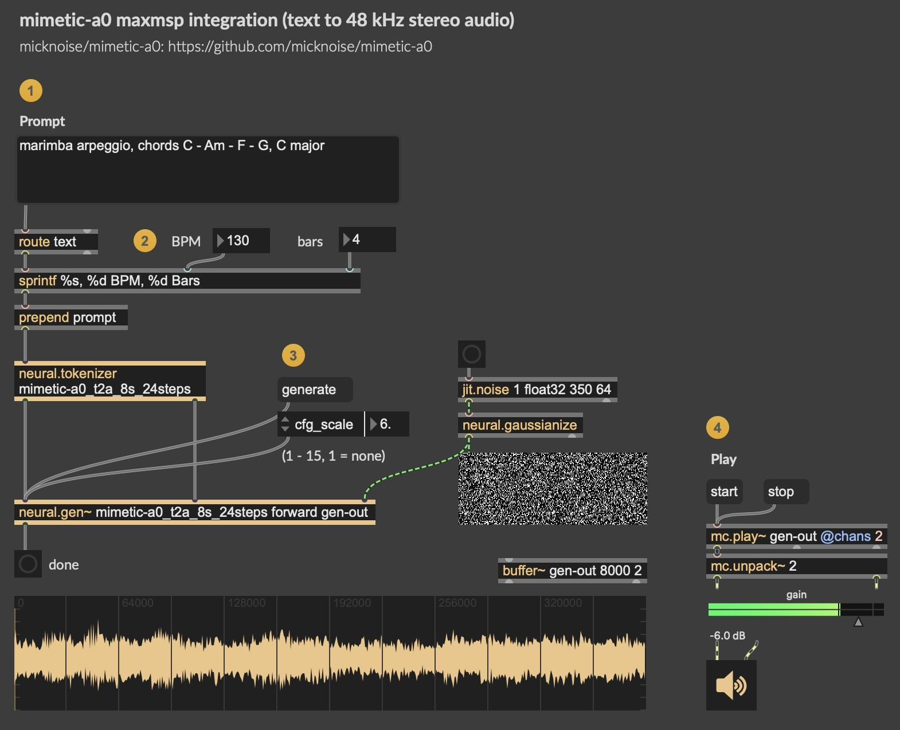

# mimetic-a0 in max/msp

**Run mimetic-a0 locally in Max/MSP (Apple Silicon GPU).**  
These scripts export mimetic-a0 to Max/MSP, using the [`neural.gen~`](https://github.com/jasper-zheng/neural_tilde) object. The model runs on the Apple Silicon GPU through an [ExecuTorch](https://pytorch.org/executorch/) MLX backend. 

**GPU acceleration:** On an M4 Max, an 8 s clip takes **1.4 s at 24 steps**. For comparison, PyTorch on the GPU (MPS) takes 2.4 s on the same clip.

**Example Patch:**  


## Requirements

### Run the pre-exported model
- An Apple Silicon Mac, peak at 14 GB in fp32.
- Max 9 with the **neural_tilde** package (0.1.0 or later). Get neural_tilde from its [releases page](https://github.com/jasper-zheng/neural_tilde/releases).

### Export the model yourself
- [uv](https://docs.astral.sh/uv/) package manager, for the Python environment.

## Export

Clone this repo:
```bash
git clone https://github.com/jasper-zheng/mimetic-a0.git
```

The exporting pipeline has its own environment (i.e., ExecuTorch 1.5.1 needs PyTorch 2.14 while mimetic-a0 uses 2.7.1), to setup:

```bash
cd mimetic_a0/maxmsp
uv sync
```
Command for exporting:
```bash
uv run python export_text_to_audio.py   # default: 8 s, 24 steps, fp32
```
**Note:** Generation length, sampling steps, and precision are fixed at export. The exported model can generate any length up to the export length. To change these parameters, re-run the export with flags:

```bash
uv run python export_text_to_audio.py --seconds 12   # export 12 s
uv run python export_text_to_audio.py --steps 16     # number of diffusion steps
uv run python export_text_to_audio.py --half         # fp16
```

Other flags:
- `--model <repo|folder>` to export local weights.
- `--seed N` sets the seed `neural.gen~` starts with.
- `--out <folder>` (default `artifacts/`).

Each export writes four files to `artifacts/`, where `<stem>` is e.g. `mimetic-a0_t2a_8s_24steps`:

| file | what it is |
|---|---|
| `<stem>.pte` | the model |
| `<stem>.json` | what `neural.gen~` reads: inputs, attributes, output |
| `<stem>.tokenizer.json` and `<stem>.tokenizer.config.json` | the T5 tokenizer, for `neural.tokenizer` |

Then check the export:

```bash
uv run python validate.py artifacts/mimetic-a0_t2a_8s_24steps.pte
```

`validate.py` runs the export through the same path Max takes. It checks:
- the interface in the `.json`
- the tokenizer, on every prompt in [docs/prompting.md](../../docs/prompting.md)
- the audio against the PyTorch pipeline, at full length, at a shorter `seconds_total`, and with and without guidance

It prints PASS or FAIL and takes a few minutes.

## Use in Max

**The example patch:** open `example-patch/mimetic-a0-8s.maxpat`. It is set to `mimetic-a0_t2a_8s_24steps`. To use your own export, add `artifacts/` to Max's search path (Options ▸ File Preferences) and change the model name in the patch's `neural.tokenizer`, `neural.gen~` and `neural.info` boxes.

1. Turn audio on.
2. Click a preset prompt, which also sets the duration, or type a prompt and press Return.
3. Click **Generate**. The clip appears in the `buffer~` and plays (enable autoplay, or click start).

**The objects:**
- `[neural.tokenizer <stem>]` turns a prompt into `input_ids` and `attention_mask`.
- `[neural.gen~ <stem> forward]` generates. It takes `set <buffer>`, then `generate`, and bangs its left outlet when the clip is ready.

**Attributes of `neural.gen~`:**

| attribute | range | what it does |
|---|---|---|
| `seconds_total` | 0 – S, default S | the duration the model aims for |
| `cfg_scale` | 1 – 15, default 6 | guidance; 1 = none |
| `seed` | | the starting noise; the same seed gives the same clip |

**Send the prompt as one symbol**, e.g. a message box holding `"house drum loop, dance kit, 120 BPM, 4 bars"` in double quotes, then `prepend prompt`. A message box splits at commas, and `neural.tokenizer` joins separate atoms with spaces, which would change the text the model sees. [docs/prompting.md](../../docs/prompting.md) explains how to write prompts; set the duration to the bars you ask for (seconds = bars × 240 ÷ BPM).

**The output is always S long:**
- After `seconds_total`, the model's own tail continues for up to 6 s. That is the headroom it was trained with, and it is kept as stock generation keeps it.
- After `seconds_total` + 6 s, the output is silent.
- The patch's player stops at `seconds_total`. Trim or fade the buffer yourself if you need an exact cut.

**Sample rate:** the buffer is set to 48 kHz, and `play~` / `groove~` resample it, so clips play at the right pitch in a 44.1 kHz session.

## How it works

`modules.py` rebuilds stock `generate()` as one graph with fixed shapes. It calls the stock stable-audio-tools modules, so their code is unchanged:

1. **Conditioning:** T5-base, in fp16 as stock runs it, plus the `seconds_start` / `seconds_total` embedders.
2. **Padding mask:** built inside the graph from `seconds_total`.
3. **Sampler:** the Euler steps, unrolled, with batch-2 classifier-free guidance using APG. The step schedule is fixed at export.
4. **Decoder:** the VAE decoder.

`export_text_to_audio.py` hands this graph to neural_tilde's `GenModule`, which lowers it to MLX. Two fixes were needed along the way:

- **`ensure_eos`.** `neural.tokenizer` encodes without special tokens, so the `</s>` that T5 expects at the end of every prompt was missing, and the output changed completely. The graph now appends it exactly as stock tokenisation does, and leaves tokens that already end in `</s>` unchanged.
- **Shorter decode.** The decoder only decodes the latents that reach the S-second output (S + 16 latents of headroom instead of S + 6 s). The kept audio is bit-identical, and the decoder takes 40 % less time and memory.

## Limits

- **Apple Silicon only,** Windows/CUDA will be supported in the next neural_tilde release.
- **Length and steps are fixed per export.** Any `seconds_total` up to S works at runtime. Below S, the take differs from the CLI's for the same noise, because the CLI shortens the latent sequence to the duration while the export always runs the full S with a mask (stock `sample_diffusion` behaviour at a fixed length). It sounds as good.
- **Memory:** generating takes about 13.6 GB at peak in the Python runtime, mostly due to the decoder working on 48 kHz audio. This was measured on a 48 GB machine.
- The first inference after loading might be a bit slower, as it also compiles the GPU kernels.

## Licence

These scripts are part of mimetic-a0 and, like its code and weights, MIT-licensed. An exported `.pte` contains the mimetic-a0 weights (MIT) and T5-base (Apache 2.0); see [NOTICE](../../NOTICE).

The exporter ([neural-tilde](https://pypi.org/project/neural-tilde/)) and the Max externals that run the export are © Jasper Shuoyang Zheng, licensed [CC BY-NC 4.0](https://creativecommons.org/licenses/by-nc/4.0/) (non-commercial). They are installed separately and not included here.
